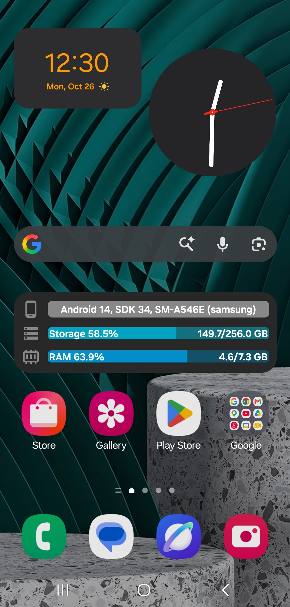

# Memory-Info-Android-Appwidget
A simple widget built using **Jetpack Glance** that displays information about storage, RAM, and the device itself. The widget updates every **3 minutes** and occupies a **4x1 cell** area.

## Preview 🖼️

## Android versions 🔃
Android 8 and later.